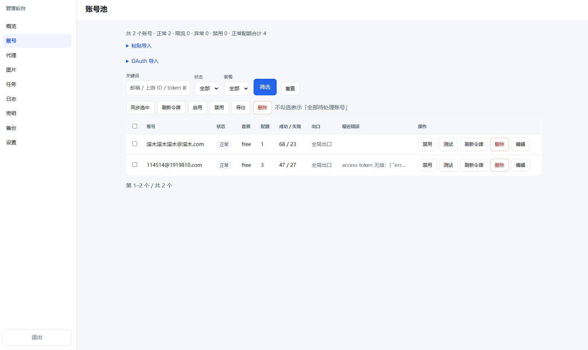
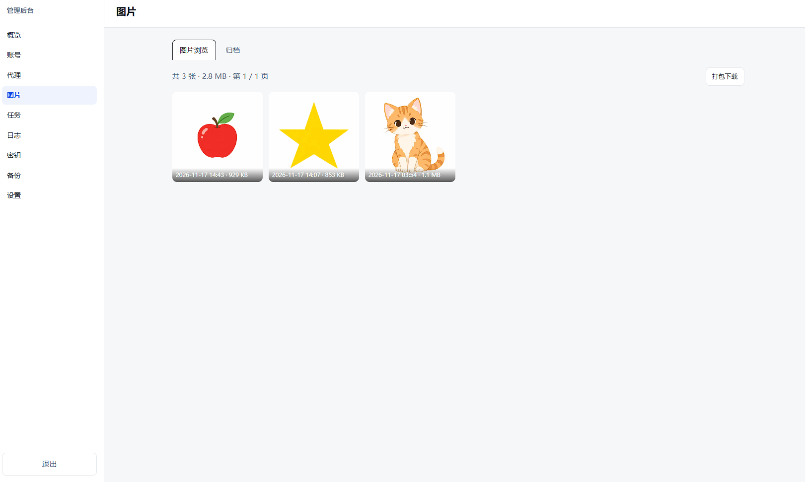
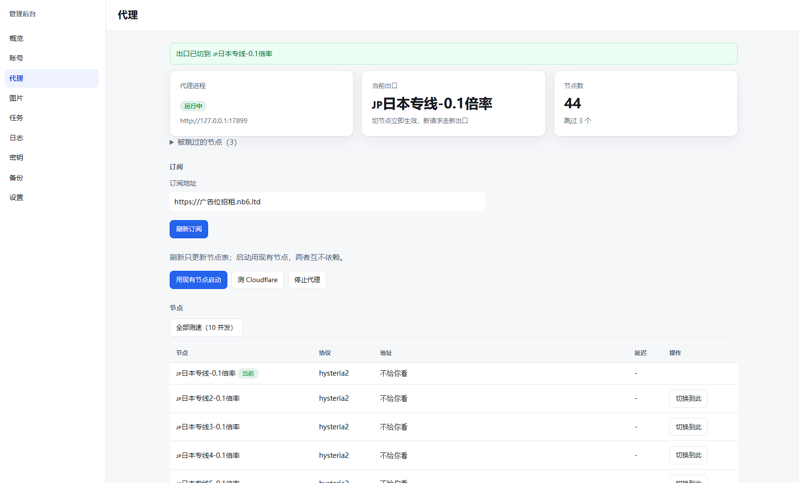

<h1 align="center">GPT2API-RS</h1>

<p align="center">
把 ChatGPT 网页版封装成自托管的 OpenAI / Anthropic 兼容接口。<br>
一个二进制，自带账号池、图片归档与管理后台。
</p>

<p align="center">
  <a href="https://github.com/HelloAIXIAOJI/gpt2apirs/actions/workflows/test.yml"></a>
  
  
</p>

<p align="center">
  <a href="#快速开始">快速开始</a> ·
  <a href="#功能">功能</a> ·
  <a href="#效果展示">效果展示</a> ·
  <a href="#api">API</a> ·
  <a href="#配置">配置</a> ·
  <a href="#常见问题">常见问题</a>
</p>

> [!WARNING]
> 本项目通过分析 ChatGPT 网页端接口提供兼容 API，仅供个人学习与技术研究使用。
>
> - 请勿用于商业用途、批量滥用或转售服务。
> - 使用本项目有账号被限流或封禁的风险，请勿使用重要账号测试。

## 快速开始

需要 Rust 与 PostgreSQL。

```bash
git clone https://github.com/HelloAIXIAOJI/gpt2apirs && cd gpt2apirs
cp .env.example .env               # 填 DATABASE_URL 与 ADMIN_KEY
cargo build --release --features tls
./target/release/gpt2apirs
```

启动后打开 `http://127.0.0.1:8000/admin`，用 `ADMIN_KEY` 登录，导入账号并在「密钥」页创建 API key。

```bash
curl http://127.0.0.1:8000/v1/chat/completions \
  -H "Authorization: Bearer $API_KEY" \
  -H "Content-Type: application/json" \
  -d '{"model":"text","messages":[{"role":"user","content":"你好"}]}'
```

## 功能

OpenAI 与 Anthropic 双协议兼容，文本支持流式输出。

### 账号池

- 支持 token 与 OAuth 授权导入
- 账号过期自动刷新，配额定期同步
- 账号失效时自动换号

### 图片

- 生图与图生图
- 图片浏览、归档与打包下载

### 出口代理

- 内置代理内核，支持 Clash 订阅
- 支持节点测速与切换

### 管理后台

- 概览、账号、图片、任务、日志、备份、设置
- 运行参数热更新，无需重启

## 效果展示

| 概览 | 账号池 |
|:---:|:---:|
|  |  |

| 图片（浏览 / 归档） | 代理（节点 / 测速） |
|:---:|:---:|
|  |  |

## API

对外提供两个模型名：`text` 与 `image`。

| 接口 | 说明 |
|---|---|
| `POST /v1/chat/completions` | 文本对话 |
| `POST /v1/responses` | Responses 格式 |
| `POST /v1/messages` | Anthropic 格式 |
| `POST /v1/messages/count_tokens` | token 计数 |
| `POST /v1/images/generations` | 文生图 |
| `POST /v1/images/edits` | 图生图 |
| `POST /v1/search` | 联网检索 |
| `GET /v1/models` | 模型列表 |

## 配置

`.env` 与可执行文件同目录。

| 变量 | 必填 | 说明 |
|---|---|---|
| `DATABASE_URL` | 是 | PostgreSQL 连接串 |
| `ADMIN_KEY` | 是 | 后台登录口令 |
| `DATA_DIR` | 否 | 图片与归档目录 |
| `PUBLIC_BASE_URL` | 否 | 对外地址 |
| `CORS_ALLOW_ORIGINS` | 否 | 允许跨站调 `/v1/*` 的来源，逗号分隔；留空放开任意来源 |

## 常见问题

**第一次请求报「未启用 tls feature」**：编译时缺少 `--features tls`。

**启动报 `DATABASE_URL` 缺失**：`.env` 不在可执行文件同目录。

**`/v1/*` 返回 401**：需使用「密钥」页创建的 API key，`ADMIN_KEY` 仅用于登录后台。

## 本地开发

```bash
cargo test --workspace
cargo check --workspace --all-targets
cargo check --workspace --all-features --all-targets
```

## 许可证

MIT。
